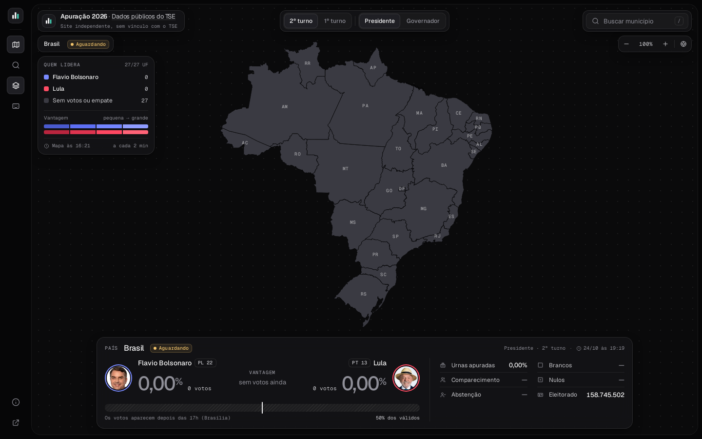
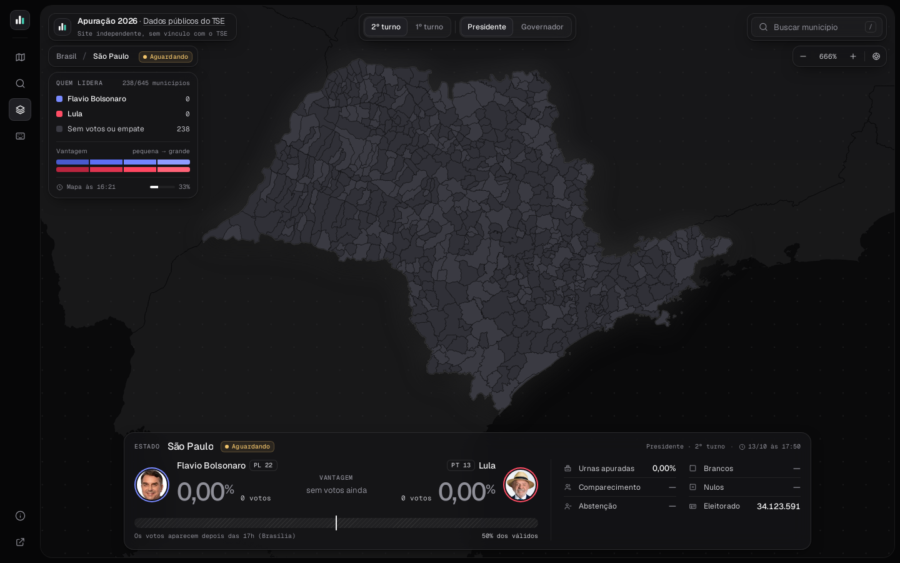
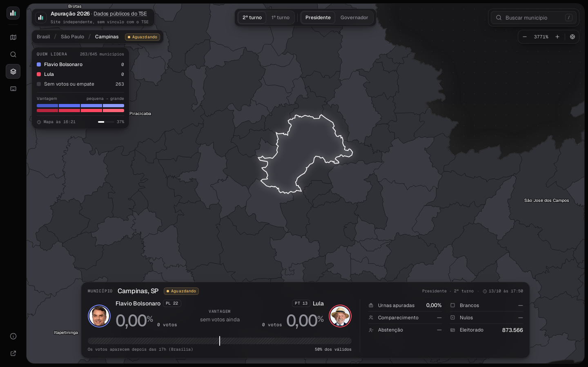
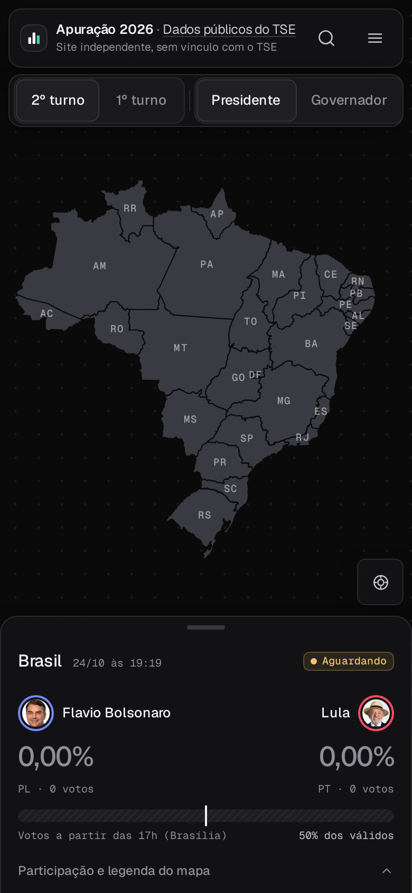
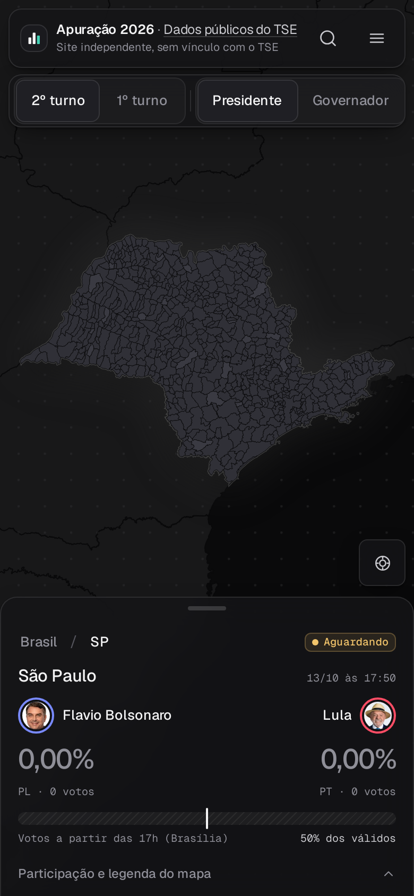

# Apuração 2026

**Ver ao vivo:** [https://apuracao-tse-eta.vercel.app](https://apuracao-tse-eta.vercel.app)

Acompanhe a apuração das Eleições Gerais 2026 com mapa interativo e números direto do TSE — sem cadastro e sem inventar voto.



## O que tem aqui

- **Painel nacional** por turno e cargo (Presidente no 2º turno por padrão): candidatos com foto do TSE, votos, percentual, barras, urnas apuradas, comparecimento, abstenção, brancos e nulos, horário da última atualização (Brasília).
- **Mapa do Brasil em tela cheia**, como um canvas: arraste, roda do mouse ou pinça para navegar. Estados coloridos pelo líder e intensidade pela margem; ao aproximar de um estado aparecem os municípios, e o painel de baixo troca sozinho para o recorte em foco. Breadcrumb e Esc para voltar.
- **Busca** de município por nome.
- **Atualização automática** a cada 60 segundos enquanto a apuração segue, com transições suaves nos números (GSAP).
- **Tema escuro**, tudo em uma tela (desktop e celular), textos em português do Brasil.





| Mobile — visão geral | Mobile — estado |
|:---:|:---:|
|  |  |

## Dados do TSE

Tudo vem dos JSON públicos em [resultados.tse.jus.br](https://resultados.tse.jus.br), o mesmo tipo de feed do app oficial **Resultados**.

| O quê | Onde |
|--------|------|
| Catálogo de eleições | `/oficial/comum/config/ele-c.json` |
| Resultado unificado (EA20) | `/oficial/ele2026/<eleição>/dados/<pasta>/<arquivo>-c<cargo>-e<eleição>-u.json` |
| Índice de municípios | `/oficial/ele2026/<eleição>/config/mun-e<eleição>-cm.json` |
| Fotos | `/oficial/ele2026/<eleição>/fotos/<uf>/<sqcand>.jpeg` |

**Códigos 2026**

| Turno | Federal (Presidente) | Estadual (Gov., Senado, Deps.) |
|--------|----------------------|--------------------------------|
| 1º (04/10) | `6257` | `6259` |
| 2º (25/10) | `6258` | `6260` |

Exemplos (2º turno, Presidente):

- Brasil: `.../6258/dados/br/br-c0001-e006258-u.json`
- São Paulo (UF): `.../6258/dados/sp/sp-c0001-e006258-u.json`
- São Paulo (município): `.../6258/dados/sp/sp71072-c0001-e006258-u.json`

O app monta essas URLs em tempo real. **Se o TSE não publicou o arquivo ou a apuração ainda não começou, a interface mostra zero votos ou erro — nunca usa número fictício.**

Atualização: `fetch` no cliente a cada **60 s** (respeitoso ao CDN; o TSE pede cautela com 404 em massa). Campos como `dg`/`hg` e `and` (`f` = totalização final) vêm do próprio JSON.

### CORS e deploy na Vercel

O CDN do TSE **não envia** `Access-Control-Allow-Origin`. O navegador **bloqueia** `fetch` direto de `https://resultados.tse.jus.br` a partir do seu domínio.

Por isso o front chama apenas **`/api/tse/...`** (mesma origem). Em produção isso **não é** função serverless nem ISR: é um **rewrite** no `vercel.json`, que encaminha a requisição ao TSE na borda da Vercel. O build continua 100% estático (`dist/`).

- **Local:** proxy no `vite.config.ts` (mesmo prefixo `/api/tse`).
- **Vercel:** `vercel.json` já incluído; não precisa de API Routes.

Se você hospedar só os arquivos estáticos **sem** rewrite equivalente, o mapa e o painel não carregam dados — por CORS, não por bug do projeto.

## Stack

- [Vite](https://vitejs.dev/) + [React](https://react.dev/) 19 + TypeScript  
- [Tailwind CSS](https://tailwindcss.com/) 4  
- [GSAP](https://gsap.com/) (animações) · [D3](https://d3js.org/) (mapas SVG)  
- GeoJSON: estados ([Click That Hood](https://github.com/codeforamerica/click_that_hood)) · municípios por UF ([geodata-br](https://github.com/tbrugz/geodata-br))

## Rodar localmente

```bash
git clone <seu-fork>
cd apuracao-2026
npm install
npm run dev
```

Abre [http://127.0.0.1:4321](http://127.0.0.1:4321). O proxy do Vite encaminha `/api/tse` ao TSE.

Opcional — baixar de novo os GeoJSON de municípios:

```bash
npm run geo:download
```

Build de produção:

```bash
npm run build
npm run preview   # serve dist/ com o mesmo proxy do Vite
```

| Comando | Saída |
|---------|--------|
| **`npm run build`** | **`dist/`** (HTML, JS, CSS e `public/` estáticos) |

## Deploy na Vercel (site estático)

1. Importe o repositório na Vercel.  
2. **Framework preset:** Vite (ou Other).  
3. **Build command:** `npm run build`  
4. **Output directory:** `dist`  
5. Não configure Serverless Functions nem ISR — não há.

O `vercel.json` do repo já define o rewrite `/api/tse → resultados.tse.jus.br`. Variáveis de ambiente e secrets **não são necessários**.

## Estrutura do projeto

```
├── docs/                 # screenshots do README
├── public/geo/           # GeoJSON (estados + municípios por UF)
├── scripts/
│   ├── download-geo.mjs  # baixa malhas IBGE via geodata-br
│   └── screenshots.mjs   # capturas (dev)
├── src/
│   ├── components/       # mapa, cards, abas, busca
│   ├── hooks/            # fetch TSE, líderes UF/município
│   ├── lib/tse/          # URLs, parse do JSON oficial, tipos
│   ├── App.tsx
│   └── main.tsx
├── vercel.json           # rewrite CORS (sem functions)
└── vite.config.ts        # proxy local
```

## Contribuir

1. Abra uma issue para discutir mudanças grandes.  
2. Fork, branch (`feat/...`), commit claro.  
3. `npm run build` e `npm run lint` sem erros.  
4. Pull request com descrição do que mudou e por quê.

Bug de dado errado: confira primeiro o JSON no site do TSE; este projeto só exibe o que o tribunal publica.

## Créditos e aviso

- **Dados eleitorais:** [Tribunal Superior Eleitoral](https://www.tse.jus.br) — divulgação oficial em `resultados.tse.jus.br`.  
- **Malhas geográficas:** IBGE, via repositórios comunitários citados acima.

**Este projeto não é oficial.** Não representa o TSE nem qualquer candidatura. Use os [canais oficiais](https://www.tse.jus.br) para decisões que dependam do resultado proclamado.

## Licença

[MIT](LICENSE) © contribuidores do Apuração 2026.
